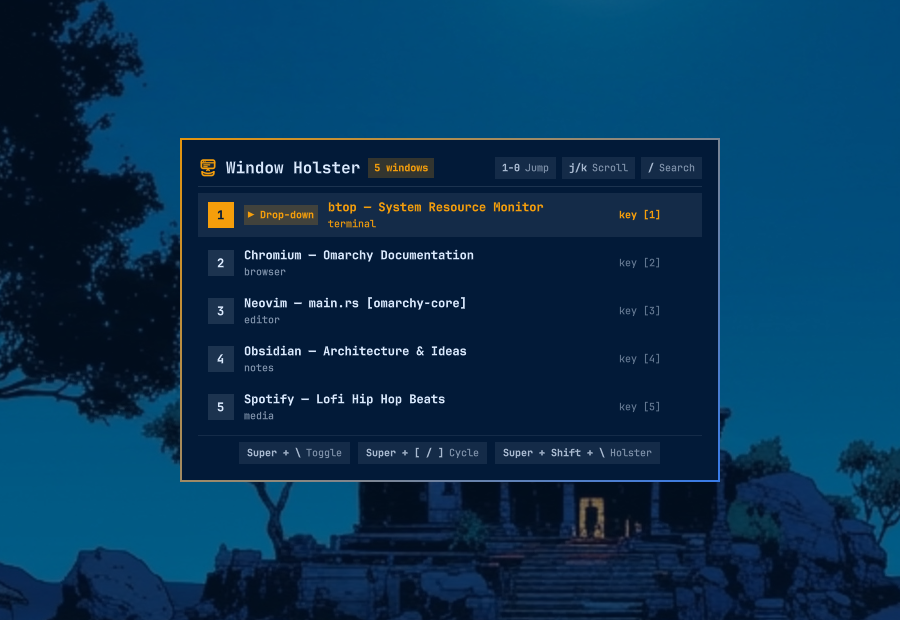

# Omarchy Window Holster 🎯

> **Quake-style drop-down, scratchpad, and multi-edge drawer for any window on Hyprland & Omarchy.**

<p align="center">
  
</p>

Turn **any application or window** into a smooth, sliding drop-down console. Holster multiple windows at your screen edges and draw them on demand with single-keystroke slot jumps, sequential cycling, or fuzzy search.

---

## 📋 Dependencies

Window Holster is lightweight and relies entirely on standard Omarchy environment tools:
- **Hyprland** (tested on Hyprland >= 0.40)
- **Python 3** (standard library only — zero pip dependencies)
- **Quickshell** (included with Omarchy)

---

## ✨ Features

- 🎮 **Quake-Style Drop-Down for Any App**: Terminal, browser, Slack, Spotify, notes, or editor — toggle any window between normal tiled layout and an edge drawer.
- 🖱️ **macOS-Style Click-to-Focus (Option B)**: Moving your mouse cursor across background tiled windows does not steal focus or dismiss the drawer. The window only holsters when you click outside or switch workspaces.
- 🎯 **Multi-Window Holster Pool**: Holster multiple windows at once without cluttering your workspace.
- ⚡ **Direct Slot Jumps (Keys `1`-`9` and `0`)**: Hit `SUPER + SHIFT + \` and immediately tap `1`-`9` or `0` (for slot 10) to unholster that window instantly.
- ⌨️ **Vim & Keyboard Navigation**: Full keyboard scrolling with `j` / `k`, arrow keys, `PageUp` / `PageDown`, and `Home` / `End`.
- 🔍 **Live Search with Dynamic Renumbering**: Tap `/` in the HUD to filter by window title or application class; search results are dynamically renumbered `1`, `2`, `3`...
- 🧭 **Multi-Edge Drawer Positions**: Slide out from `top`, `bottom`, `left`, `right`, or pop up in the `center`.
- 🎨 **Native Omarchy QML HUD**: Built with Omarchy's native `qs.Ui` component kit matching your active theme, blur, and font styling.
- 📊 **Status Bar Widget**: Optional bar icon showing holstered window count, left-click to toggle, right-click to configure.

---

## 📦 Installation

Install directly via the Omarchy plugin CLI or Omanager store:

```bash
omarchy plugin add https://github.com/srihari93/omarchy-window-holster --enable
```

> **⚡ Zero Setup Required**:
> The plugin automatically adds `omarchy-window-holster` to your `$PATH` and registers the default Hyprland shortcuts immediately out of the box! You can start pressing `Super + \` right away.

---

## 🗑️ Removal & Uninstallation

To remove the plugin from Omarchy:

```bash
omarchy plugin remove omarchy-window-holster
```

Optionally clean up the CLI symlink and state files if desired:
```bash
rm -f ~/.local/bin/omarchy-window-holster ~/.config/omarchy/holster.json
```

---

## ⌨️ Default Keybindings

The following shortcuts work out of the box:

| Shortcut | Action | Description |
| :--- | :--- | :--- |
| `SUPER + \` | **Toggle Holster** | Quake-style drop-down: shows or hides the active/last-holstered window |
| `SUPER + ]` | **Cycle Forward** | Cycles to the next holstered window |
| `SUPER + [` | **Cycle Back** | Cycles to the previous holstered window |
| `SUPER + ALT + \` | **Toggle Window Role** | Holsters active window into drawer (or unholsters it back to tiled layout) |
| `SUPER + SHIFT + \` | **Interactive HUD** | Opens Native Selector HUD: keys `1`-`0` jump, `j`/`k` scroll, `/` search, `Esc` dismiss |

### Submap / HUD Keys:
- **`1` – `9`**: Instantly activate slots 1 through 9.
- **`0`**: Instantly activate slot 10.
- **`j` / `Down`**: Navigate selection down.
- **`k` / `Up`**: Navigate selection up.
- **`PageUp` / `PageDown`**: Jump 5 items up or down.
- **`Home` / `End`**: Jump to the first or last holstered window.
- **`/`**: Enter live filter search mode.
- **`Esc`**: Exit search mode, or dismiss HUD.

---

## 🛠️ Customizing Keybindings (Optional)

Default shortcuts are persisted in `~/.config/hypr/bindings.lua`. You can edit or rebind any shortcut at any time:

```lua
-- Omarchy Window Holster (Quake-style drawer & scratchpad)
local holster_bin = "omarchy-window-holster"

hl.unbind("SUPER + backslash")
hl.unbind("SUPER + bracketright")
hl.unbind("SUPER + bracketleft")
hl.unbind("SUPER + ALT + backslash")
hl.unbind("SUPER + SHIFT + backslash")

o.bind("SUPER + backslash", "Window Holster: Toggle", holster_bin .. " toggle")
o.bind("SUPER + bracketright", "Window Holster: Cycle Forward", holster_bin .. " cycle next")
o.bind("SUPER + bracketleft", "Window Holster: Cycle Back", holster_bin .. " cycle prev")
o.bind("SUPER + ALT + backslash", "Window Holster: Toggle Active Window", holster_bin .. " toggle-role")
o.bind("SUPER + SHIFT + backslash", "Window Holster: Select Window", holster_bin .. " select")

hl.define_submap("holster", function()
  for i = 1, 9 do
    hl.unbind(tostring(i))
    hl.bind(tostring(i), hl.dsp.exec_cmd(holster_bin .. " activate " .. i))
  end
  hl.unbind("0")
  hl.bind("0", hl.dsp.exec_cmd(holster_bin .. " activate 10"))
  hl.unbind("j")
  hl.bind("j", hl.dsp.exec_cmd(holster_bin .. " cycle next"))
  hl.unbind("Down")
  hl.bind("Down", hl.dsp.exec_cmd(holster_bin .. " cycle next"))
  hl.unbind("k")
  hl.bind("k", hl.dsp.exec_cmd(holster_bin .. " cycle prev"))
  hl.unbind("Up")
  hl.bind("Up", hl.dsp.exec_cmd(holster_bin .. " cycle prev"))
  hl.unbind("backslash")
  hl.bind("backslash", hl.dsp.exec_cmd(holster_bin .. " toggle"))
  hl.unbind("bracketright")
  hl.bind("bracketright", hl.dsp.exec_cmd(holster_bin .. " cycle next"))
  hl.unbind("bracketleft")
  hl.bind("bracketleft", hl.dsp.exec_cmd(holster_bin .. " cycle prev"))
  hl.unbind("slash")
  hl.bind("slash", hl.dsp.exec_cmd(holster_bin .. " select"))
  hl.unbind("space")
  hl.bind("space", hl.dsp.exec_cmd(holster_bin .. " select"))
  hl.unbind("escape")
  hl.bind("escape", hl.dsp.exec_cmd(holster_bin .. " submap-exit"))
  hl.unbind("")
  hl.bind("", hl.dsp.exec_cmd(holster_bin .. " submap-exit"), { catchall = true })
end)
```

---

## 🛠️ Configuration (`~/.config/omarchy/holster.json`)

```json
{
  "position": "top",
  "width": 100,
  "height": 40
}
```

### Supported Positions:
- `top` (Full-width drop-down anchored to top edge)
- `center-top` (Centered floating top console)
- `bottom` (Rise up from the bottom edge)
- `center-bottom` (Centered bottom dock/tray)
- `left` / `center-left` (Slide-out sidebar on the left)
- `right` / `center-right` (Slide-out sidebar on the right)
- `center` (Floating modal pop-up)

---

## 🖥️ Graphical Preferences Panel

Open the native configuration panel anytime:
```bash
omarchy-window-holster config
```
Or right-click the Window Holster icon on your Omarchy status bar.

---

## 🔍 Attention & Discovery Keywords

`quake`, `quake-style`, `quake-mode`, `guake`, `yakuake`, `tilda`, `drop-down`, `dropdown`, `dropdown-terminal`, `visor`, `totalterminal`, `holster`, `window-holster`, `scratchpad`, `scratchpads`, `pyprland`, `drawer`, `window-drawer`, `sliding-window`, `edge-drawer`, `side-panel`, `dock`, `tdrop`, `hyprland`, `hyprland-scratchpad`, `hyprland-plugin`, `wayland`, `omarchy`, `omarchy-plugin`, `special-workspace`, `window-manager`, `tiling`, `submap`, `slot-selector`, `quick-switch`, `quick-terminal`, `multi-window`, `floating`, `overlay`, `popup`, `hud`, `hotkey`, `shortcuts`, `productivity`, `tui`

---

## 📄 License

[MIT License](LICENSE) © 2026 P. Sri Hari Raju
