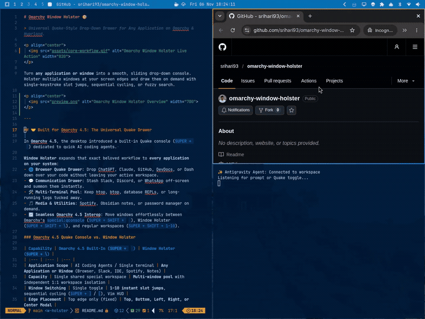

# Omarchy Window Holster 🎯

> **Universal Quake-Style Drop-Down Drawer for Any Application on Omarchy & Hyprland.**

<p align="center">
  
</p>

Turn **any application or window** into a smooth, sliding drop-down console. Holster multiple windows at your screen edges and draw them on demand with single-keystroke slot jumps, sequential cycling, or fuzzy search.

---

## 🤝 Built for Omarchy 4.5: The Universal Quake Drawer

In **Omarchy 4.5**, the desktop introduced a built-in Quake console (`SUPER + ` ` `) dedicated to quick AI coding agents. 

**Window Holster** expands that exact beloved workflow to **every application on your system**:
- 🌐 **Browser Quake Drawer**: Drop ChatGPT, Claude, GitHub, DevDocs, or Dash down over your code without leaving your active workspace.
- 💬 **Communication Drawer**: Stash Slack, Discord, or WhatsApp off-screen and summon them instantly.
- 🛠️ **Multi-Terminal Pool**: Keep htop, btop, database REPLs, or long-running logs tucked away.
- 🎵 **Media & Utilities**: Spotify, Obsidian notes, or password manager on demand.
- 🔄 **Seamless Omarchy 4.5 Interop**: Move windows effortlessly between Omarchy's `special:qconsole` (`SUPER + SHIFT + ` ` `), Window Holster (`SUPER + SHIFT + \`), and regular workspaces (`SUPER + SHIFT + 1–10`).

### Omarchy 4.5 Quake Console vs. Window Holster

| Capability | Omarchy 4.5 Built-In (`SUPER + ` ` `) | Window Holster (`SUPER + \`) |
| :--- | :--- | :--- |
| **Application Scope** | AI Coding Agents / Single terminal | **Any Application or Window** (Browser, Slack, IDE, Spotify, Notes) |
| **Capacity** | Single shared special workspace | **Multi-window pool** with independent 1:1 workspace isolation |
| **Window Switching** | Single toggle | **1–10 instant slot jumps**, sequential cycling (`SUPER + ]` / `[`), Vim HUD |
| **Edge Placement** | Top edge only (fixed) | **Top, Bottom, Left, Right, or Center Modal** |
| **Mouse Interaction** | Standard hover/sloppy focus | **macOS-Style Click-to-Focus** (hovering background does not dismiss) |
| **Status Bar Presence** | None | **Dynamic 3-state vector SVG widget** (`empty` → `stashed` → `open`) |
| **Customization** | Lua gaps editing | **Native graphical preferences panel** with live sliders & edge selector |

---

## 📋 Dependencies

Window Holster is lightweight and relies entirely on standard Omarchy environment tools:
- **Hyprland** (tested on Hyprland >= 0.40 & Omarchy 4.5)
- **Python 3** (standard library only — zero pip dependencies)
- **Quickshell** (included with Omarchy)

---

## ✨ Features

- 🎮 **Quake-Style Drop-Down for Any App**: Terminal, browser, Slack, Spotify, notes, or editor — toggle any window between normal tiled layout and an edge drawer.
- 🖱️ **macOS-Style Click-to-Focus (Option B)**: Moving your mouse cursor across background tiled windows does not steal focus or dismiss the drawer. The window only holsters when you click outside or switch workspaces.
- 🎯 **Multi-Window Holster Pool**: Holster multiple windows at once without cluttering your workspace.
- ⚡ **Direct Slot Jumps (Keys `1`-`9` and `0`)**: Hit `SUPER + CTRL + \` and immediately tap `1`-`9` or `0` (for slot 10) to unholster that window instantly.
- ⌨️ **Vim & Keyboard Navigation**: Full keyboard scrolling with `j` / `k`, arrow keys, `PageUp` / `PageDown`, and `Home` / `End`.
- 🔍 **Live Search with Dynamic Renumbering**: Tap `/` in the HUD to filter by window title or application class; search results are dynamically renumbered `1`, `2`, `3`...
- 🧭 **Multi-Edge Drawer Positions**: Slide out from `top`, `bottom`, `left`, `right`, or pop up in the `center`.
- 🎨 **Native Omarchy QML HUD**: Built with Omarchy's native `qs.Ui` component kit matching your active theme, blur, and font styling.
- 🎨 **Theme-Adaptive Vector Icons**: Clean handcrafted SVG vector icons that dynamically inherit Omarchy bar theme colors via `currentColor` and `MultiEffect` colorization.
- 📊 **Dynamic 3-State Vector Bar Widget**: Tactical holster vector icon (`empty` → `stashed` → `open`) with dynamic counter badge, left-click for drawer panel, right-click to cycle windows.
- 🛡️ **Linux-Native Crash Safety**: Backed by `prctl(PR_SET_PDEATHSIG)` watchdog — if the shell restarts or exits, all hidden windows are immediately returned to visible workspaces.

---

## 🎬 Live Demos & Feature Showcase

### 1. ⚡ Core Quake Workflow: Holster, Drop-Down & Cycle
Stash any window into your drawer with `SUPER + SHIFT + \`. Drop it down instantly over your code with `SUPER + \`, cycle through stashed apps with `SUPER + ]`, and unholster back to a tiled layout whenever you're done.

<p align="center">
  
</p>

---

### 2. 🎯 Interactive Selector HUD & Direct Slot Jumps
Press `SUPER + CTRL + \` to summon the native QML Selector HUD. Jump instantly to any window by pressing its slot number (`1`–`9` or `0` for 10), scroll with Vim keys (`j` / `k`), or tap `/` for real-time fuzzy filtering.

<p align="center">
  
</p>

---

### 3. 📊 Dynamic Topbar GUI & Preferences Panel
Click the Window Holster widget on your Omarchy status bar for instant management:
- **Left-Click**: Opens the native preferences panel displaying your active window pool (with individual `Unholster` and `Restore All` actions), live `Width` and `Height` sliders, edge position dropdown, and shortcut reference cheat sheet.
- **Right-Click**: Cycles directly through holstered windows with the Quake drawer sliding down over your workspace.

<p align="center">
  
</p>

---

### 4. 🧭 Multi-Edge Docking (Top, Left, Bottom, Right)
Window Holster isn't limited to a top drop-down. Configure any window to slide out from any screen edge:
- **Center-Top**: Classic Quake-style drop-down drawer.
- **Left / Right Sidebar**: Vertical sliding drawer for file managers, chat, or documentation.
- **Center-Bottom**: Slide-up console tray for terminal logs and REPLs.

<p align="center">
  
</p>

---

## 📦 Installation

Install directly via the Omarchy plugin CLI or Omanager store:

```bash
omarchy plugin add https://github.com/srihari93/omarchy-window-holster --enable
```

> **⚡ Zero Setup Required**:
> The plugin automatically adds `omarchy-window-holster` to your `$PATH` and registers the default Hyprland shortcuts immediately out of the box! You can start pressing `Super + \` right away.

---

## 🗑️ Removal & Uninstallation

To remove the plugin from Omarchy:

```bash
omarchy plugin remove omarchy-window-holster
```

Optionally clean up the CLI symlink and state files if desired:
```bash
rm -f ~/.local/bin/omarchy-window-holster ~/.config/omarchy/holster.json
```

---

## ⌨️ Default Keybindings

The following shortcuts work out of the box:

| Shortcut | Action | Description |
| :--- | :--- | :--- |
| `SUPER + \` | **Toggle Holster** | Quake-style drop-down: shows or hides the active/last-holstered window |
| `SUPER + ]` | **Cycle Forward** | Cycles to the next holstered window |
| `SUPER + [` | **Cycle Back** | Cycles to the previous holstered window |
| `SUPER + SHIFT + \` | **Toggle Window Role** | Holsters active window into drawer (or unholsters it back to tiled layout) |
| `SUPER + CTRL + \` | **Interactive HUD** | Opens Native Selector HUD: keys `1`-`0` jump, `j`/`k` scroll, `/` search, `Esc` dismiss |

### Submap / HUD Keys:
- **`1` – `9`**: Instantly activate slots 1 through 9.
- **`0`**: Instantly activate slot 10.
- **`j` / `Down`**: Navigate selection down.
- **`k` / `Up`**: Navigate selection up.
- **`PageUp` / `PageDown`**: Jump 5 items up or down.
- **`Home` / `End`**: Jump to the first or last holstered window.
- **`/`**: Enter live filter search mode.
- **`Esc`**: Exit search mode, or dismiss HUD.

---

## 🛠️ Customizing Keybindings (Optional)

Default shortcuts are persisted in `~/.config/hypr/bindings.lua`. You can edit or rebind any shortcut at any time:

```lua
-- Omarchy Window Holster (Quake drawer for any window)
local holster_bin = "omarchy-window-holster"

hl.unbind("SUPER + backslash")
hl.unbind("SUPER + bracketright")
hl.unbind("SUPER + bracketleft")
hl.unbind("SUPER + SHIFT + backslash")
hl.unbind("SUPER + CTRL + backslash")

o.bind("SUPER + backslash", "Window Holster: Toggle", holster_bin .. " toggle")
o.bind("SUPER + bracketright", "Window Holster: Cycle Forward", holster_bin .. " cycle next")
o.bind("SUPER + bracketleft", "Window Holster: Cycle Back", holster_bin .. " cycle prev")
o.bind("SUPER + SHIFT + backslash", "Window Holster: Toggle Active Window", holster_bin .. " toggle-role")
o.bind("SUPER + CTRL + backslash", "Window Holster: Select Window", holster_bin .. " select")

hl.define_submap("holster", function()
  for i = 1, 9 do
    hl.unbind(tostring(i))
    hl.bind(tostring(i), hl.dsp.exec_cmd(holster_bin .. " activate " .. i))
  end
  hl.unbind("0")
  hl.bind("0", hl.dsp.exec_cmd(holster_bin .. " activate 10"))
  hl.unbind("j")
  hl.bind("j", hl.dsp.exec_cmd(holster_bin .. " cycle next"))
  hl.unbind("Down")
  hl.bind("Down", hl.dsp.exec_cmd(holster_bin .. " cycle next"))
  hl.unbind("k")
  hl.bind("k", hl.dsp.exec_cmd(holster_bin .. " cycle prev"))
  hl.unbind("Up")
  hl.bind("Up", hl.dsp.exec_cmd(holster_bin .. " cycle prev"))
  hl.unbind("backslash")
  hl.bind("backslash", hl.dsp.exec_cmd(holster_bin .. " toggle"))
  hl.unbind("bracketright")
  hl.bind("bracketright", hl.dsp.exec_cmd(holster_bin .. " cycle next"))
  hl.unbind("bracketleft")
  hl.bind("bracketleft", hl.dsp.exec_cmd(holster_bin .. " cycle prev"))
  hl.unbind("slash")
  hl.bind("slash", hl.dsp.exec_cmd(holster_bin .. " select"))
  hl.unbind("space")
  hl.bind("space", hl.dsp.exec_cmd(holster_bin .. " select"))
  hl.unbind("escape")
  hl.bind("escape", hl.dsp.exec_cmd(holster_bin .. " submap-exit"))
  hl.unbind("")
  hl.bind("", hl.dsp.exec_cmd(holster_bin .. " submap-exit"), { catchall = true })
end)
```

---

## 🛠️ Configuration (`~/.config/omarchy/holster.json`)

```json
{
  "position": "top",
  "width": 100,
  "height": 40
}
```

### Supported Positions:
- `top` (Full-width drop-down anchored to top edge)
- `center-top` (Centered floating top console)
- `bottom` (Rise up from the bottom edge)
- `center-bottom` (Centered bottom dock/tray)
- `left` / `center-left` (Slide-out sidebar on the left)
- `right` / `center-right` (Slide-out sidebar on the right)
- `center` (Floating modal pop-up)

---

## 🖥️ Graphical Preferences Panel

Open the native configuration panel anytime:
```bash
omarchy-window-holster config
```
Or click the Window Holster icon on your Omarchy status bar (left-click opens the panel, right-click cycles windows).

---

## 🔍 Attention & Discovery Keywords

`omarchy-4-5`, `omarchy-quake`, `qconsole`, `quake-console`, `agent-drawer`, `agent-console`, `universal-quake`, `quake-for-apps`, `multi-window-quake`, `browser-quake`, `dropdown-drawer`, `app-stash`, `smart-scratchpad`, `sliding-console`, `terminal-drawer`, `top-drawer`, `omarchy-extension`, `quickshell-plugin`, `hyprland-0-56`, `quake`, `quake-style`, `quake-mode`, `guake`, `yakuake`, `tilda`, `drop-down`, `dropdown`, `dropdown-terminal`, `visor`, `totalterminal`, `holster`, `window-holster`, `scratchpad`, `scratchpads`, `pyprland`, `drawer`, `window-drawer`, `sliding-window`, `edge-drawer`, `side-panel`, `dock`, `tdrop`, `hyprland`, `hyprland-scratchpad`, `hyprland-plugin`, `wayland`, `omarchy`, `omarchy-plugin`, `special-workspace`, `window-manager`, `tiling`, `submap`, `slot-selector`, `quick-switch`, `quick-terminal`, `multi-window`, `floating`, `overlay`, `popup`, `hud`, `hotkey`, `shortcuts`, `productivity`, `tui`

---

## 📄 License

[MIT License](LICENSE) © 2026 P. Sri Hari Raju
